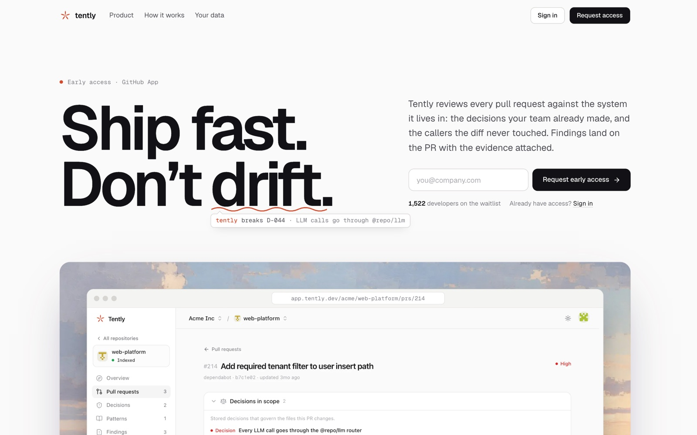
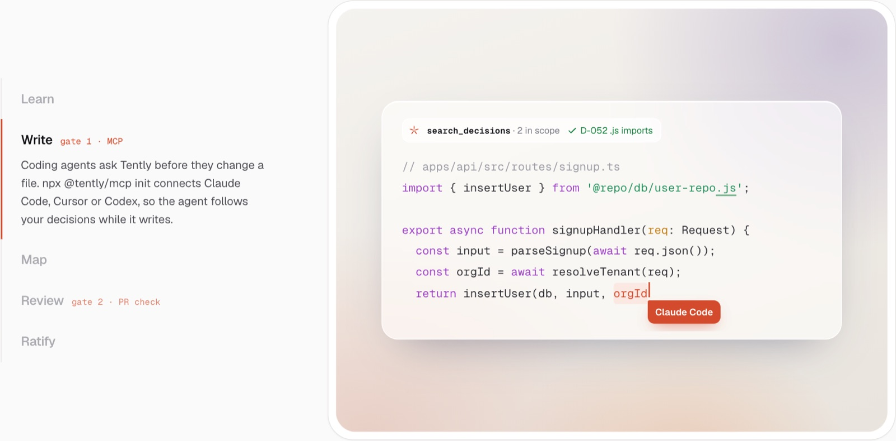
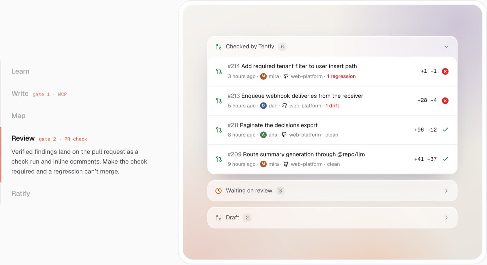
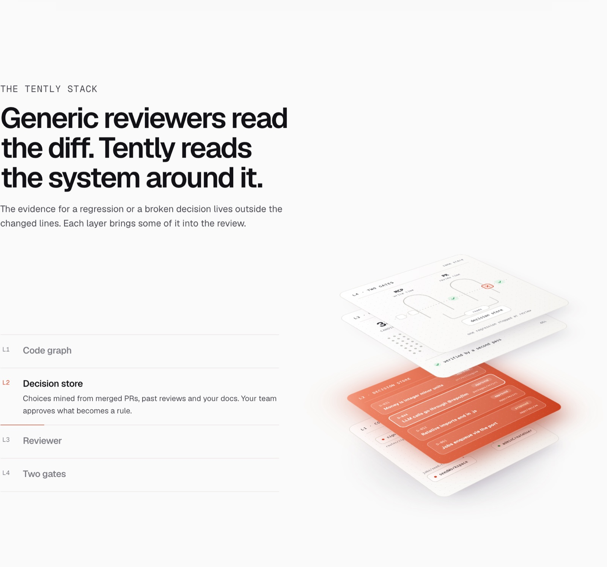
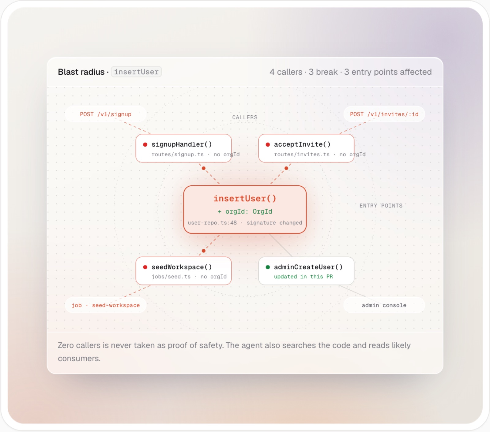
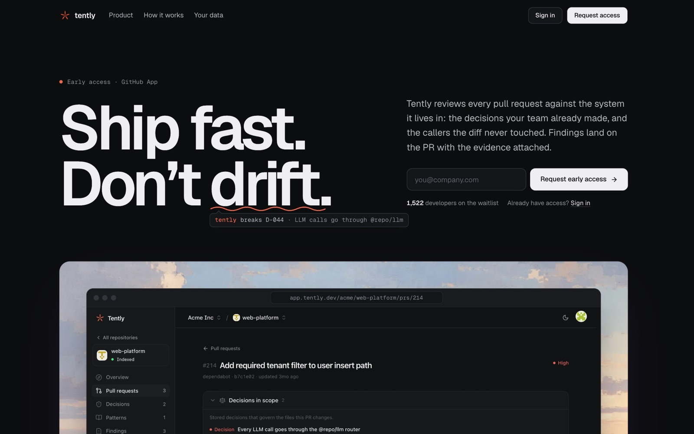

# product-landing-design

An agent skill for designing and building product-first landing pages for SaaS and developer tools. The style is calm, glassy and led by real screenshots, in the spirit of sites like tembo.io and linear.app. It also teaches agents what makes a page look AI-generated, so they avoid it.

Works with Claude Code, Codex, Cursor and any other agent that reads `SKILL.md` skills.



## What it teaches

- **A visual system.** Warm neutral tokens for light and dark, one accent color, Geist and Geist Mono, spacing and layout rules, icon and motion rules.
- **The bezel.** A white ring around a soft wash with frosted glass cards inside. Used for every code, list, log and screenshot showcase.
- **Section recipes.** Hero with a framed product shot, logo strip, 3D layer stack, vertical stepper with one switching showcase, code card with a typing cursor, grouped PR or activity list, blast-radius style illustration, event timeline, closing CTA on an image, footer.
- **Real screenshots.** How to capture the product in light and dark with Playwright at the right size, and serve them with `<picture>`.
- **SVG illustrations that look designed.** A generator script approach, Figma-style rules, dark mode inside the SVG file, and a contact-sheet review.
- **What to avoid.** A checklist of the patterns that make a page read as AI-generated.
- **QA.** A screenshot pass at desktop and phone width in both themes, plus the pitfalls that are easy to hit (font variables, crops, class collisions, animations, form layouts).

| Vertical stepper with a code card | Grouped pull request list |
| --- | --- |
|  |  |

| 3D layer stack | Illustration card |
| --- | --- |
|  |  |

The screenshots are from [tently.dev](https://tently.dev), which was built with this skill.

## Install

### Any agent (Skills CLI)

```sh
npx skills add MOHAMAD-ZUBI/product-landing-design
```

Add `-g` to install it for your user instead of the current project, and `-a claude-code` (or another agent) to pick the agent.

### Claude Code plugin

```text
/plugin marketplace add MOHAMAD-ZUBI/product-landing-design
/plugin install product-landing-design@product-landing-design
```

### Manual

Copy `skills/product-landing-design/SKILL.md` into your agent's skills folder. For Claude Code that is `~/.claude/skills/product-landing-design/SKILL.md`.

## Use

Ask your agent for a landing page, a marketing site or a redesign, for example:

> Redesign our landing page in the style of tembo.io. Use real screenshots of the app.

The skill loads when the request matches. In Claude Code you can also call it directly with `/product-landing-design`.

## Dark mode

Every token, screenshot and illustration in the skill has a dark variant.



## License

MIT
